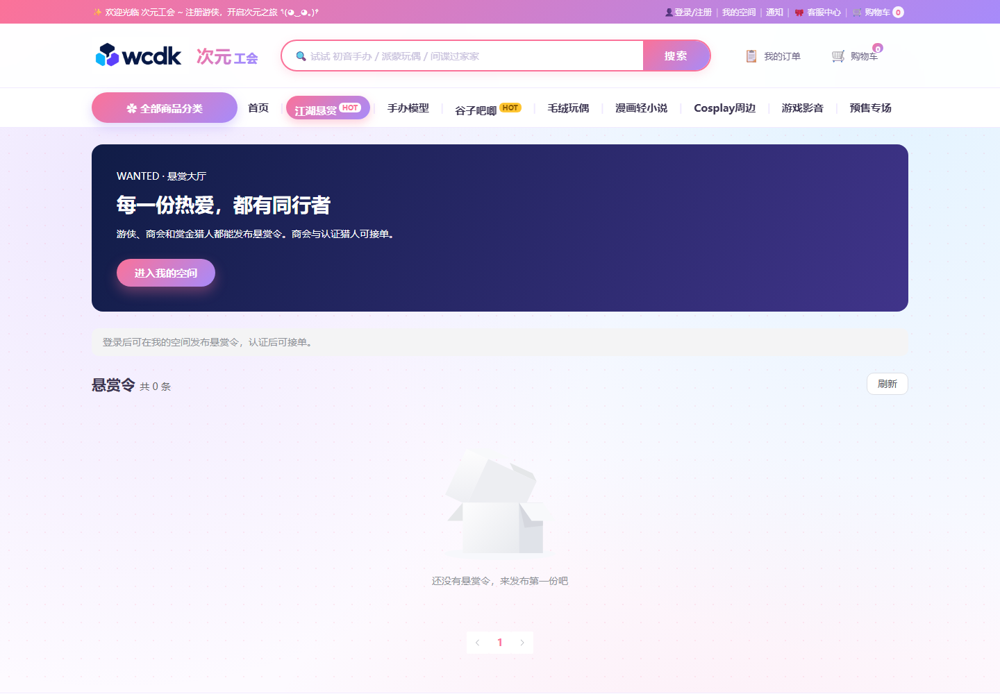

# WCDK R2DBC

WCDK R2DBC 是一个基于 Spring Boot、Spring Data R2DBC 和 Project Reactor 的响应式数据库访问框架，面向 WebFlux 微服务和响应式业务场景。

[](LICENSE)
[](https://www.oracle.com/java/)
[](https://spring.io/projects/spring-boot)

## 项目简介

WCDK R2DBC 是一个面向 **Spring Boot 3.5.x、Spring Data R2DBC 和 Project Reactor** 的响应式数据库访问框架，适用于 Spring WebFlux 微服务和响应式业务系统。它提供 Repository 动态代理、响应式 CRUD、派生查询、QueryWrapper、事务、多数据源、逻辑删除、XML SQL 以及达梦、PostgreSQL、MySQL 和 Oracle 数据库方言支持。

## Project Overview

WCDK R2DBC is a reactive database access framework for **Spring Boot 3.5.x, Spring Data R2DBC, and Project Reactor**. It is designed for Spring WebFlux microservices and reactive applications, providing dynamic Repository proxies, reactive CRUD, derived queries, QueryWrapper, transactions, multi-datasource routing, logical deletion, XML SQL, and dialect support for Dameng, PostgreSQL, MySQL, and Oracle.

## 为什么选择 WCDK R2DBC？

- **保持全链路响应式**：Repository、Service 和 Controller 统一使用 `Mono` / `Flux`，适配 WebFlux，避免阻塞式 JDBC 编程模型。
- **减少样板代码**：通过 Repository 动态代理、标准 CRUD 和派生查询方法，快速构建数据访问层。
- **兼顾易用性与控制力**：简单查询使用方法名约定和 QueryWrapper，复杂场景使用 XML SQL 和自定义生命周期拦截器。
- **面向企业数据库场景**：内置事务、多数据源、逻辑删除、连接池、SQL 观测和多数据库方言支持。
- **渐进式接入**：可以从基础 Repository 开始使用，按需启用分页、QueryWrapper、XML SQL、事务和观测能力。

## Why Choose WCDK R2DBC?

- **End-to-end reactive programming**: Keep `Mono` / `Flux` across Repository, Service, and Controller layers for Spring WebFlux applications.
- **Less boilerplate**: Build the data access layer quickly with dynamic Repository proxies, standard CRUD operations, and derived query methods.
- **Simple for common cases, flexible for complex cases**: Use method-name conventions and QueryWrapper for common queries, and XML SQL or lifecycle interceptors when deeper control is needed.
- **Built for enterprise database scenarios**: Includes transactions, multi-datasource routing, logical deletion, connection pooling, SQL observability, and dialect support for multiple databases.
- **Adopt incrementally**: Start with the basic Repository API and enable pagination, QueryWrapper, XML SQL, transactions, or observability as needed.

## 目录

- [在线案例](#在线案例)
- [特性](#特性)
- [环境要求](#环境要求)
- [快速开始](#快速开始)
- [配置](#配置)
- [Repository API](#repository-api)
- [@Transient 字段](#transient-字段)
- [派生查询方法](#派生查询方法)
- [QueryWrapper](#querywrapper)
- [API 迁移](#api-迁移)
- [分页](#分页)
- [逻辑删除](#逻辑删除)
- [多数据源](#多数据源)
- [事务](#事务)
- [XML SQL](#xml-sql)
- [XML 映射契约](#xml-仓储与实体映射契约)
- [SQL 生命周期与观测](#sql-生命周期与观测)
- [扩展 Bean](#自动配置扩展-bean)
- [仓储生命周期与雪花 ID](#仓储生命周期方法与雪花-id)
- [数据库支持](#数据库支持)
- [响应式使用约束](#响应式使用约束)
- [项目结构](#项目结构)

## 在线案例

基于 WCDK R2DBC 的在线案例：[次元工会](http://120.26.144.72/#/)。案例展示了商品浏览、悬赏大厅、购物车和订单等典型业务页面。

### 首页


### 悬赏大厅



## 特性

- **响应式 API**：仓储查询统一返回 `Mono` / `Flux`，适配 Spring WebFlux。
- **Repository 动态代理**：启动时扫描接口并生成仓储代理，业务代码只需定义接口。
- **标准 CRUD**：提供新增、按 ID 查询、更新、删除、列表、单条、统计和存在性查询。
- **派生方法**：支持 `findBy`、`countBy`、`existsBy`、`deleteBy`、`update<更新字段>By<条件字段>` 等方法名约定。
- **查询构造器**：支持实体属性名或映射列名，覆盖等值、范围、模糊、集合、空值、嵌套 `AND` / `OR`、排序、分页。
- **逻辑删除**：查询、统计、更新和派生删除默认过滤已删除数据。
- **多数据源路由**：支持通过 `@R2dbcDataSource` 和 Reactor Context 切换数据源。
- **响应式事务**：提供 `TransactionalOperator`、模板事务和手动事务能力。
- **XML SQL**：支持 XML 语句、动态 SQL、结果类型和结果映射。
- **SQL 生命周期**：支持 SQL 执行前后拦截、审计、性能统计和 Micrometer 观测。
- **数据库方言**：支持达梦、PostgreSQL、MySQL 和 Oracle 的方言适配。
- **连接池**：基于 `r2dbc-pool` 管理连接池参数。
- **类型映射**：支持实体、记录类、枚举、Java 时间类型以及自定义值转换器。

## 环境要求

本轮验收基于 Spring Boot 3.5.16 / JDK 21；其他主版本和数据库版本需在目标环境另行验证。

- Java 21（本项目 Maven 构建限定 JDK 21）
- Spring Boot 3.5.x
- Maven 3.9+
- 对应数据库的 R2DBC 驱动

## 快速开始

### 1. 添加依赖

```xml
<dependency>
    <groupId>io.github.wcdk</groupId>
    <artifactId>wcdk-r2dbc</artifactId>
    <version>3.5.16</version>
</dependency>

<!-- 按实际数据库选择一个驱动 -->
<dependency>
    <groupId>org.postgresql</groupId>
    <artifactId>r2dbc-postgresql</artifactId>
    <version>1.0.7.RELEASE</version>
    <scope>runtime</scope>
</dependency>
```

WCDK 已依赖 `spring-boot-starter-data-r2dbc`，应用无需重复声明该 starter。数据库驱动需要由应用显式引入；本项目 profile 中的驱动为 optional 依赖，不会自动传递给使用方。达梦、MySQL、Oracle 驱动版本可参考项目 `pom.xml` 的 profile 配置。

### 2. 配置数据库

```yaml
spring:
  r2dbc:
    url: r2dbc:postgresql://localhost:5432/demo
    username: postgres
    password: postgres

wcdk:
  r2dbc:
    enabled: true
    sql-log-enabled: false
    snowflake-worker-id: 12  # 示例节点；部署时为每个进程分配唯一编号
```

以上为 PostgreSQL 配置。达梦使用 `r2dbc:dm://127.0.0.1:5236` 形式；不要将 PostgreSQL 的数据库路径照搬为达梦 schema。目标 schema 应结合登录用户与会话设置确认，框架不会自动为每条连接执行 `SET SCHEMA`。URL 额外参数是否受支持，以实际使用的达梦驱动版本为准。

### 3. 启用仓储扫描

```java
package com.example;

import com.wcdk.r2dbc.config.EnableWcdkR2dbcRepositories;
import org.springframework.boot.SpringApplication;
import org.springframework.boot.autoconfigure.SpringBootApplication;

@EnableWcdkR2dbcRepositories(basePackages = "com.example.repository")
@SpringBootApplication
public class Application {

    public static void main(String[] args) {
        SpringApplication.run(Application.class, args);
    }
}
```

### 4. 定义实体和仓储

分别保存为 `User.java` 和 `UserRepository.java`；以下代码省略重复的 package/import。

```java
package com.example.repository;

import com.wcdk.r2dbc.annotation.Repository;
import com.wcdk.r2dbc.repository.BaseRepository;
import org.springframework.data.annotation.Id;
import org.springframework.data.relational.core.mapping.Column;
import org.springframework.data.relational.core.mapping.Table;
import reactor.core.publisher.Flux;

@Table("sys_user")
public record User(
        @Id Long id,
        @Column("user_name") String userName,
        String email,
        Integer status
) {
}

@Repository
public interface UserRepository extends BaseRepository<User> {
    Flux<User> findByStatus(Integer status);
}
```

> 历史注解 `com.wcdk.r2dbc.Repository` 已弃用，迁移到 `com.wcdk.r2dbc.annotation.Repository`；兼容入口计划在 4.0.0 移除。基础仓储接口使用 `com.wcdk.r2dbc.repository.BaseRepository`。

### 5. 在 Service 中使用

```java
@Service
@RequiredArgsConstructor
public class UserService {

    private final UserRepository userRepository;

    public Mono<User> findById(Long id) {
        return userRepository.selectById(id);
    }

    public Flux<User> findEnabledUsers() {
        return userRepository.findByStatus(1);
    }

    public Mono<User> create(User user) {
        return userRepository.insert(user);
    }
}
```

Controller、Service 和 Repository 之间应保持 `Mono` / `Flux` 链路，不要调用 `block()` 或在业务方法中手动 `subscribe()`。

## 配置

完整示例见 [`application-example.yml`](src/main/resources/application-example.yml)。

### WCDK 配置项

| 配置项 | 默认值 | 说明 |
|---|---:|---|
| `wcdk.r2dbc.enabled` | `false` | 是否启用 WCDK R2DBC |
| `wcdk.r2dbc.base-packages` | 未指定 | 显式仓储扫描包；设置后不追加默认包 |
| `wcdk.r2dbc.transaction.aspect-enabled` | `false` | 是否启用 WCDK 自定义响应式事务切面 |
| `wcdk.r2dbc.database-type` | 空 | 单数据源 WCDK 回退工厂的驱动提示及 Schema 初始化的类型提示；通常从 URL/连接元数据检测 |
| `wcdk.r2dbc.sql-log-enabled` | `false` | 是否输出原始参数、可执行完整 SQL 及审计终态 |
| `wcdk.r2dbc.sql-log-complete-enabled` | `false` | 兼容旧配置；开启 SQL 日志后始终打印完整 SQL，此项不再控制输出 |
| `wcdk.r2dbc.sensitive-columns` | 保留旧默认值 | 兼容旧配置；不再对日志参数脱敏，此项不再生效 |
| `wcdk.r2dbc.observability-enabled` | `false` | 是否启用 Micrometer 观测 |
| `wcdk.r2dbc.snowflake-id` | `false` | 是否启用雪花 ID 生成 |
| `wcdk.r2dbc.snowflake-worker-id` | 未指定；须提供节点来源 | 节点编号，0–1023；跨进程必须唯一 |
| `wcdk.r2dbc.quote-identifier` | `true` | 是否引用数据库标识符；仓储按连接方言生成，MySQL使用反引号，PostgreSQL/Oracle/达梦使用双引号 |
| `wcdk.r2dbc.mapper-locations` | `classpath*:repository/**/*.xml` | XML Mapper 扫描位置 |
| `wcdk.r2dbc.strict-unused-parameters` | `true` | XML 未使用方法入参报错；设为 false 可暂时保留旧行为 |
| `wcdk.r2dbc.logic-delete-field` | `delFlg` | 逻辑删除字段 |
| `wcdk.r2dbc.logic-not-delete-value` | `0` | 未删除值 |
| `wcdk.r2dbc.logic-delete-value` | `1` | 已删除值 |

WCDK 事务切面默认关闭；Spring 标准事务 Advisor 的启用不受此开关控制。如需使用 WCDK 响应式事务切面，可显式开启（同时需要 `wcdk.r2dbc.enabled=true`）：

```yaml
wcdk:
  r2dbc:
    transaction:
      aspect-enabled: true
```

数据库初始化配置位于 `wcdk.r2dbc.database-initializer`：

| 配置项 | 默认值 | 说明 |
|---|---:|---|
| `wcdk.r2dbc.database-initializer.enabled` | `false` | 是否初始化 Schema |
| `wcdk.r2dbc.database-initializer.sql-location` | `classpath*:sql/**/*.sql` | SQL 资源模式 |
| `wcdk.r2dbc.database-initializer.database-type` | 空 | 初始化专用类型提示 |
| `wcdk.r2dbc.database-initializer.mode` | `always` | always / never / embedded |
| `wcdk.r2dbc.database-initializer.ignore-errors` | `true` | 仅恢复错误码白名单中的异常 |
| `wcdk.r2dbc.database-initializer.execute-in-transaction` | `true` | 使用同一连接执行事务初始化 |
| `wcdk.r2dbc.database-initializer.timeout` | `30s` | 总等待上限，必须为正数；超时取消并使启动失败 |

初始化类型优先级为初始化器专用 `database-type` > `wcdk.r2dbc.database-type` > 历史 `database.type` > 连接元数据。

单数据源通常由 Spring Boot 的 `R2dbcAutoConfiguration` 创建连接工厂；WCDK 在它之后装配，仅当没有任何连接工厂、配置了 `spring.r2dbc.url` 且没有多数据源配置时创建回退工厂。可在排除 Spring Boot R2DBC 自动配置或仅导入 WCDK 自动配置的环境使用该回退。Boot 或用户提供的连接工厂优先，WCDK 类型提示不会覆盖其驱动；多数据源按各自 URL 和配置选择驱动。上下文关闭时 WCDK 只释放自己创建的工厂及连接池；应用或 Spring Boot 提供的工厂由其提供方管理。

### 初始化脚本选择与错误处理

初始化器以 `sql-location` 的资源根为起点，按相对路径完整目录段（`dm`/`dameng`、`mysql`、`oracle`、`postgresql`/`postgres`）及文件名前缀（如 `mysql-schema.sql`、`dm_schema.sql`）识别数据库专属脚本。找到目标数据库专属脚本时仅执行这些脚本，否则执行通用脚本；其他数据库目录中的普通 `schema.sql` 不会进入通用回退。`admin.sql`、`add_column.sql`、`user_id_map.sql` 均为通用脚本。资源查找失败会报告路径并阻止初始化。部署路径祖先目录中的 `oracle` 等名称不参与脚本归属判定；初始化总等待受 `timeout` 限制，数据库无法连接或执行不结束时启动失败。

`ignore-errors=true` 只恢复错误码白名单中的数据库异常（包括 Spring 包装的底层 R2DBC 异常）：SQLSTATE `42P07`、`42710`、`42S01`、`42S02` 或厂商码 `955`、`942`。仅出现 “already exists”等消息不会被忽略；未知驱动错误、其他错误码继续失败。每次忽略记录数据库类型、脚本、SQLSTATE、错误码和原因。`ignore-errors=false` 时白名单错误也会失败。事务模式下，错误信号恢复不会改变数据库自身的事务中止及 DDL 隐式提交规则；需要重复执行含可能失败 DDL 的脚本时使用非事务初始化。

### 仓储生命周期方法与雪花 ID

仓储生命周期直接传递执行计划中的实际 `Method`，保留声明接口、参数类型和 `@Param` 注解；不按方法名搜索重载。继承方法沿用父接口声明，覆写方法使用子接口声明。实体泛型覆写支持具体参数类型，编译器生成的默认桥接方法转发到具体方法；默认接口方法内部调用会重新进入仓储代理。`findAll` 的参数数组为空，`selectOne` 的生命周期方法仍为 `selectOne`。分页 count 阶段保留原 `selectPage` 方法与完整分页参数。

雪花节点解析优先级为：`wcdk.r2dbc.snowflake-worker-id` 显式配置 → 应用提供的 `WorkerIdResolver`（无自定义 Bean 时使用 `WCDK_R2DBC_WORKER_ID` 环境变量解析器）。自动配置会提供默认 `SnowflakeIdGenerator` Bean，因此启用 WCDK 时须提供节点来源；`snowflake-id=false` 只关闭仓储自动填充。默认缺少节点配置时启动失败；开发环境只有显式设置 `WCDK_R2DBC_WORKER_ID_FALLBACK=digest` 才启用主机/进程摘要回退。编号必须为 0–1023 的整数，解析失败、越界或解析器报告租约冲突均使默认生成器创建失败。回退会警告跨进程碰撞风险，生产多实例部署应明确分配唯一节点或使用注册中心租约。

```yaml
wcdk:
  r2dbc:
    snowflake-id: true
    snowflake-worker-id: 12
```

可声明 `com.wcdk.r2dbc.id.WorkerIdResolver` Bean 接入注册中心。解析器负责取得并维持节点独占租约，发生冲突时抛出异常；租约失效必须停止对应节点的 ID 生成。显式配置会跳过解析器的 `resolveWorkerId()`，不要同时配置需要解析器取得租约的节点。自定义 `SnowflakeIdGenerator` Bean 会替换默认生成器。

默认生成器使用 `AtomicLong`/CAS 更新时间与序列，同一应用类加载器内相同 workerId 的生成器共享状态，避免多次实例化产生重复 ID。跨进程和进程重启的唯一性需要节点分配、租约及可靠时钟共同保证，摘要回退不提供分布式冲突检测。ID 位布局保持不变：41 位时间、10 位节点、12 位序列。

**回拨行为变更**：任何幅度的时钟回拨立即抛出 `IllegalStateException`，不再容忍 1 秒以内回拨。时钟恢复后可以重试；调用方应通过响应式延迟重试避免阻塞事件线程。每毫秒 4096 个序列耗尽时以短暂休眠等待下一毫秒，不持有互斥锁，也不忙等；等待会响应线程中断，并在回拨时失败。该同步方法仍可能等待，需严格避免事件线程等待的场景可将批量 ID 分配调度到工作线程。CAS 去除了全局互斥锁，但吞吐仍受时钟粒度、同一节点序列上限及竞争影响，不保证在所有环境中更快。验证与吞吐记录见 [第 7 节验证记录](docs/validation/2026-10-10-section-7.md)。

## Repository API

推荐导入：

```java
import com.wcdk.r2dbc.annotation.Repository;
import com.wcdk.r2dbc.repository.BaseRepository;
```

| 方法 | 返回值 | 说明 |
|---|---|---|
| `insert(entity)` | `Mono<T>` | 插入并返回带主键的实体；record 回填时可能返回新实例 |
| `deleteById(id)` | `Mono<Long>` | 按 ID 删除，返回影响行数 |
| `updateById(entity)` | `Mono<Long>` | 按 ID 更新非 null 字段，兼容历史行为 |
| `updateByIdIgnoringNulls(entity)` | `Mono<Long>` | 按 ID 更新非 null 字段，null 表示保留原值 |
| `updateByIdIncludingNulls(entity)` | `Mono<Long>` | 按 ID 更新全部非主键持久化字段，null 表示将列置为 NULL |
| `selectById(id)` | `Mono<T>` | 按 ID 查询 |
| `findAll()` | `Flux<T>` | 查询全部数据 |
| `selectList(wrapper)` | `Flux<T>` | 条件查询列表 |
| `selectOne(wrapper)` | `Mono<T>` | 查询单条数据 |
| `selectCount(wrapper)` | `Mono<Long>` | 条件统计 |
| `exists(wrapper)` | `Mono<Boolean>` | 判断数据是否存在 |
| `selectPage(pageable, wrapper)` | `Mono<Page<T>>` | 分页查询 |
| `selectPage(pageable)` | `Mono<Page<T>>` | 使用空 QueryWrapper 的分页默认入口 |

基础 CRUD 更新/删除返回 `Mono<Long>`。派生及 XML 更新/删除可按契约声明 `Mono<Long>`、`Mono<Integer>`、`Mono<Boolean>`、`Mono<Void>`；XML 返回实体时必须有类型兼容的实体入参。

### 更新 null 语义与迁移

`updateById` 保持忽略 null 的行为。建议局部更新迁移到 `updateByIdIgnoringNulls`，让 null 表示保留数据库原值。需要将列置空时，使用 `updateByIdIncludingNulls`：它更新全部非主键持久化字段（包括逻辑删除字段），因此应提供其他字段需保留的值；`@Transient` 字段不参与更新，数据库 NOT NULL 约束仍然生效。

```java
// 局部更新：null 字段保持原值。
Mono<Long> patchRows = userRepository.updateByIdIgnoringNulls(patch);

// 完整更新：先加载实体以保留其他字段，再将指定字段置空。
Mono<Long> clearRows = userRepository.selectById(id)
        .flatMap(user -> {
            User cleared = new User(user.id(), user.userName(), null, user.status());
            return userRepository.updateByIdIncludingNulls(cleared);
        });
```

三个入口都返回数据库实际影响行数。没有可更新字段时直接返回 `0`，不会生成空 `SET` SQL；忽略 null 模式下全 null 会短路，包含 null 模式下则会执行置空。未匹配记录或逻辑删除过滤导致的 `0` 不会被当作成功更新。更新入口不提供自动乐观锁版本校验；需要乐观锁时可用 XML 在 WHERE 中显式校验版本，并检查影响行数是否为 `1`。XML 更新按 SQL 指定列执行，`#{name}` 的 null 参数绑定为带类型的 NULL，也可直接写 `SET name = NULL`；其他列保持原值。

## `@Transient` 字段

实体中的 `@Transient` 应使用 `org.springframework.data.annotation.Transient`。这类字段不会被当作数据表列参与实体元数据解析，因此不会出现在自动生成的 INSERT、UPDATE 以及其他基于实体字段生成的 SQL 中。

`@Transient` 不会阻止查询结果映射：如果 SELECT 结果包含与该字段匹配的列（字段名按默认规则转换，或使用 `@Column` 指定列名），RowMapper 会在实体创建完成后填充该字段。查询结果不包含该列时，字段保持默认值。

```java
@Table("sys_user")
public class User {

    @Id
    private Long id;

    @Column("user_name")
    private String userName;

    @Transient
    @Column("display_label")
    private String displayLabel;
}
```

例如，以下 PostgreSQL/MySQL 的 XML SQL 或自定义 SELECT 可以返回计算列；Oracle 的 CONCAT 仅接受两个参数，需改为嵌套 CONCAT 或字符串连接运算：

```sql
SELECT id, user_name, CONCAT(user_name, ' (active)') AS display_label
FROM sys_user
```

使用持久化构造器时，`@Transient` 字段不需要作为构造器参数；框架会先完成构造器映射，再根据查询结果补充该字段。`@Transient` 只影响持久化字段识别，不会自动生成计算列，SQL 仍需显式返回对应列。

## 派生查询方法

框架在仓储代理创建阶段解析方法名，并生成对应的执行计划。常用形式如下：

```java
public interface UserRepository extends BaseRepository<User> {
    Flux<User> findByStatus(Integer status);
    Flux<User> findByStatusAndEmail(Integer status, String email);
    Flux<User> findByStatusOrEmail(Integer status, String email);
    Mono<Long> countByStatus(Integer status);
    Mono<Boolean> existsByEmail(String email);
    Mono<Long> deleteByStatus(Integer status);
    Mono<Integer> updateUserNameById(String userName, Long id);
}
```

支持的常见操作包括：

- `findBy`、`countBy`、`existsBy`、`deleteBy`
- `updateXxxById`、`updateXxxByField`
- `And`、`Or`、`OrderBy`
- 无后缀等值、`Not`、`Like`、`Between`
- `GreaterThan`、`GreaterThanEqual`、`LessThan`、`LessThanEqual`
- `In`、`NotIn`、`IsNull`、`IsNotNull`

### 派生更新方法

派生更新统一使用单 `By` 语法：

```text
update<更新字段>By<条件字段>
```

`By` 前面是需要写入的字段，后面是筛选记录的条件字段。方法参数顺序固定为“更新值在前、条件值在后”：

```java
public interface UserRepository extends BaseRepository<User> {
    // 更新一个字段：SET status = ? WHERE id = ?
    Mono<Long> updateStatusById(Integer status, Long id);

    // 更新多个字段：SET user_name = ?, status = ? WHERE id = ?
    Mono<Long> updateUserNameAndStatusById(String userName, Integer status, Long id);

    // 使用多个条件：SET status = ? WHERE email = ? AND id = ?
    Mono<Long> updateStatusByEmailAndId(Integer status, String email, Long id);
}
```

调用时保持同样的参数顺序：

```java
Mono<Long> updated = userRepository.updateUserNameAndStatusById(
        "新用户名",
        1,
        1001L
);
```

更新或删除方法可以声明为 `Mono<Long>`、`Mono<Integer>`、`Mono<Boolean>` 或 `Mono<Void>`；推荐使用 `Mono<Long>` 获取数据库实际影响行数。实体配置逻辑删除字段时，派生更新会自动过滤已删除记录。

方法名中的分隔符固定写为 `By`，例如 `updateAgeById`。实体字段本身包含 `By` 时仍可识别，例如字段 `updatedBy` 对应 `updateUpdatedByById`：其中第一个 `By` 属于字段名，第二个 `By` 是更新字段与条件字段的分隔符。

`Equals`、`StartingWith`、`EndingWith` 不在当前算子集合中。

方法名中的字段必须能映射到实体属性；方法参数数量和返回类型不符合约定时，应在应用启动阶段修正，而不是在请求链路中兜底。

### 派生条件与统一命名规则

派生条件在仓储编译时生成唯一模型，字段校验、参数绑定和 SQL 计划复用该模型。支持的算子及参数数量为：无后缀 `=`、`Not`、`Like`、`In`、`NotIn`、`GreaterThan`、`GreaterThanEqual`、`LessThan`、`LessThanEqual` 各 1 个参数；`Between` 为 2 个；`IsNull`、`IsNotNull` 不接收参数。未知字段、无效后缀和声明参数数量不符均在启动编译阶段报错，运行时也会检查参数数组长度。

条件按实体字段名及映射列名的最长匹配解析，再识别 `And`/`Or`。因此 `BrandAndModel` 对应完整属性 `brandAndModel`（如果该属性存在），不会被拆成 `brand` 与 `model`。字段相同前缀存在歧义时，优先选择最长字段；例如存在 `nameOrBrand` 时，`findByNameOrBrand` 需要一个参数。`Brand`、`Coordinator`、`anderson`、`coOrdinator` 等字段也使用同一规则。映射列名的下划线可在方法名中省略；所有候选仍来自实体白名单。

`OrderBy` 排序也在编译阶段解析，支持 `OrderByIdDescNameAsc` 或方向之间以 `And` 连接；生成的 SQL 与预编译排序计划使用同一字段列表。

默认表名和列名统一使用 `com.wcdk.r2dbc.mapping.NamingStrategy`：在小写/数字转大写，以及连续大写缩写与后续单词之间加下划线。例如 `URLValue → url_value`、`userID → user_id`、`CPUTime → cpu_time`、`XMLHTTPParser → xmlhttp_parser`。显式 Spring Data `@Table`、字段 `@Column` 保留原名；构造器参数的本项目 `@Column` 仍优先指定读取列。标识符引用在命名之后由数据库方言处理。

**命名迁移**：连续大写以前可能被逐字拆分；现有数据库若使用 `u_r_l_value` 等旧列名，请添加显式 `@Column("u_r_l_value")`，旧表名可用 `@Table` 保留。

SQL 命令类型统一为 `com.wcdk.r2dbc.execution.SqlCommandType`，包含 `INSERT`、`UPDATE`、`DELETE`、`SELECT`、`MERGE`、`UNKNOWN`。直接使用旧 `query.xml.SqlCommandType`、`repository.plan.SqlCommandType`、`CustomMethodResolver.SqlCommandType` 或 `QueryCommandType` 的扩展代码需要修改 import；原 `NONE` 使用 `UNKNOWN`。XML 计划使用语句实际命令，派生执行生命周期使用生成 SQL 的实际命令（逻辑删除为 UPDATE）。

## QueryWrapper

当前 QueryWrapper 位于 `com.wcdk.r2dbc.query`，推荐使用条件表达式 API：

```java
import com.wcdk.r2dbc.query.QueryWrapper;

QueryWrapper<User> wrapper = new QueryWrapper<>();
wrapper.eq("status", 1)
       .and(nested -> nested
               .like("email", "%@example.com")
               .or(or -> or.isNull("user_name")
                          .eq("user_name", "管理员")))
       .orderByDesc("id")
       .limit(20)
       .offset(0);

Flux<User> users = userRepository.selectList(wrapper);
```

常用方法：

`eq`、`ne`、`gt`、`ge`、`lt`、`le`、`like`、`in`、`inArray`、`notIn`、`notInArray`、`isNull`、`isNotNull`、`and`、`or`、`orderByAsc`、`orderByDesc`、`limit`、`offset`、`page`。

`and` / `or` 会先生成条件表达式树，再渲染为 SQL。连续普通条件默认使用 `AND`，
同一种连续逻辑会合并；混用 `AND` / `OR` 时会保留括号来维持优先级。以下示例仅展示
`WHERE` 片段，实际执行时字段会按实体元数据映射为数据库列名：

| QueryWrapper 写法 | 生成的 WHERE 片段 |
|---|---|
| `new QueryWrapper<>()` | 空字符串 |
| `.and(n -> {})` | 空字符串 |
| `.or(n -> {})` | 空字符串 |
| `.and(n -> n.eq("a", 1))` | `WHERE a = :p0` |
| `.or(n -> n.eq("a", 1))` | `WHERE a = :p0` |
| `.eq("a", 1).eq("b", 2)` | `WHERE (a = :p0 AND b = :p1)` |
| `.eq("a", 1).and(n -> n.eq("b", 2))` | `WHERE (a = :p0 AND b = :p1)` |
| `.eq("a", 1).or(n -> n.eq("b", 2))` | `WHERE (a = :p0 OR b = :p1)` |
| `.eq("a", 1).and(n -> n.eq("b", 2).eq("c", 3))` | `WHERE (a = :p0 AND (b = :p1 AND c = :p2))` |
| `.eq("a", 1).or(n -> n.eq("b", 2).eq("c", 3))` | `WHERE (a = :p0 OR (b = :p1 AND c = :p2))` |
| `.eq("a", 1).and(n -> n.eq("b", 2).or(o -> o.eq("c", 3)))` | `WHERE (a = :p0 AND (b = :p1 OR c = :p2))` |
| `.eq("a", 1).or(n -> n.eq("b", 2).or(o -> o.eq("c", 3)))` | `WHERE (a = :p0 OR (b = :p1 OR c = :p2))` |

`eq(column, null)` 会渲染为 `column IS NULL`，`ne(column, null)` 会渲染为
`column IS NOT NULL`；空 `IN` 渲染为 `1 = 0`，空 `NOT IN` 渲染为 `1 = 1`。
IN/NOT IN 集合中的 null 元素按实体字段类型绑定为空值，保留 SQL 三值逻辑；例如 `in("id", Arrays.asList(1L, null))` 生成两项绑定，不等同于 `id = 1 OR id IS NULL`。集合在构建时快照，后续修改不会影响查询。
如果实体配置了逻辑删除字段，Repository 查询构建时还会自动追加未删除条件。

条件仅保存在 `expression()` 返回的 AST 中，普通条件、嵌套条件和 `copy()` 使用同一份表达式模型。`QueryWrapper` 没有 `conditions()` 访问器。

## 分页

`QueryWrapper.page(pageNo, pageSize)` 页码从 1 开始，`PageRequest` 页码从 0 开始。limit 为 1–Integer.MAX_VALUE，offset 支持非负 long；页码乘法溢出时抛出明确错误，已设置的 limit/offset 保持不变。
仅设置 `offset(n)` 时会跳过前 n 行并返回其余行，建议同时指定稳定排序。各方言生成的子句如下：

| 方言 | offset-only（n=20） |
| --- | --- |
| PostgreSQL | `OFFSET 20` |
| MySQL | `LIMIT 18446744073709551615 OFFSET 20` |
| Oracle / 达梦 | `OFFSET 20 ROWS` |


```java
import org.springframework.data.domain.Page;
import org.springframework.data.domain.PageRequest;
import org.springframework.data.domain.Sort;

Mono<Page<User>> result = userRepository.selectPage(
        PageRequest.of(0, 20, Sort.by(Sort.Order.desc("id"))),
        new QueryWrapper<User>().eq("status", 1)
);
```

`PageRequest` 的页码从 `0` 开始。QueryWrapper 的 `page(pageNo, pageSize)` 使用从 `1` 开始的业务页码，并自动设置 `limit` 和 `offset`。

分页 `limit` 支持 `1..Integer.MAX_VALUE`，超出范围在执行 SQL 前抛出 `IllegalArgumentException`，不会截断为负数。`offset` 保持 long，允许超过 Integer.MAX_VALUE，但不能为负数；页码计算溢出同样会报错。

`selectPage` 将 `Pageable.getSort()` 应用到记录查询的 ORDER BY，COUNT 查询不排序。排序属性通过实体元数据白名单映射，支持 Java 属性名及 `@Column` 列名；未知字段、表别名限定名和 SQL 表达式会报错。支持 ASC/DESC，使用数据库默认的大小写和空值排序规则；`ignoreCase`、`nullsFirst` 和 `nullsLast` 暂不支持，传入时会报错。

`selectPage(pageable)` 默认方法通过仓储代理调用双参数入口，相当于传入空 QueryWrapper，使用同一套排序和字段校验规则。

同时设置两侧排序时，Pageable 排序键在前，QueryWrapper 的其他排序键依次追加；同一映射列只出现一次，使用 Pageable 中首次指定的方向。例如 Pageable 按 `id DESC`，Wrapper 按 `id ASC, name ASC`，最终为 `id DESC, name ASC`，且不会修改 Wrapper。Pageable 无排序时使用 Wrapper 排序，两侧均无排序时不生成 ORDER BY。`Pageable.unpaged(sort)` 仍应用排序，但不追加分页限制。迁移时应检查此前同时指定两侧排序的调用，因为原先被忽略的 Pageable 排序现在具有优先级。

## 逻辑删除

默认逻辑删除配置为：

```yaml
wcdk:
  r2dbc:
    logic-delete-field: delFlg
    logic-not-delete-value: 0
    logic-delete-value: 1
```

实体包含对应字段时，查询、统计、存在性判断、更新和派生删除会自动过滤已删除数据。物理删除和逻辑删除的具体方法行为以实体元数据和仓储方法类型为准。

QueryWrapper 和派生条件按实体字段白名单识别逻辑删除列，支持 Java 属性名、`@Column` 映射列名和大小写变体，判定不受 `quote-identifier` 开关影响。QueryWrapper 会检查整个条件 AST（包括嵌套 AND/OR、IN 和空值判断）：显式指定逻辑删除列时使用用户条件，不再追加默认未删除条件；相似列名、排序列和参数值不会关闭默认过滤。空 IN/NOT IN 也属于显式条件，分别渲染为恒假/恒真。条件字段不接受 `u.del_flg` 等表别名限定名或 SQL 片段；例如 `eq("delFlg", 1)` 可显式查询已删除数据。

## 多数据源

配置多个数据源时，将 `spring.r2dbc` 改为 `spring.r2dbc.data-sources`，并指定主数据源：

```yaml
spring:
  r2dbc:
    primary: master
    data-sources:
      master:
        url: r2dbc:postgresql://localhost:5432/master
        username: postgres
        password: postgres
      report:
        url: r2dbc:postgresql://localhost:5432/report
        username: postgres
        password: postgres
```

在 Service 或方法上指定数据源（`reportRepository` 为 `BaseRepository<UserReport>`）：

```java
@R2dbcDataSource("report")
public Flux<UserReport> queryReport() {
    return reportRepository.findAll();
}
```

注解包路径为 `com.wcdk.r2dbc.datasource.R2dbcDataSource`。单数据源场景继续使用 `spring.r2dbc.url`；只有在由 WCDK 创建多数据源时才需要配置 `spring.r2dbc.data-sources` 和 `primary`。

数据源标识通过 Reactor Context 传递；不要使用普通 `ThreadLocal` 假设数据源上下文一定存在。

Spring 实际事务持有的连接决定数据源钉扎；`R2dbcDataSourceContext` 与动态连接工厂在选库和取连接时执行守卫。活跃事务中选择其他数据源会抛出包含源、目标和拒绝原因的 `IllegalStateException`。默认主数据源使用路由工厂的真实 `primary` 键；显式选择该键不算切库。非路由的单连接工厂使用任意选库键仍访问同一工厂，不触发跨库拒绝。

请在事务获取连接前完成选库；跨库独立事务使用下方的传播作用域入口。没有实际事务时各链可以独立选库，WCDK 不提供跨数据源分布式事务语义。

## 事务

Spring 环境下优先使用响应式事务：

```java
@Service
@RequiredArgsConstructor
public class UserService {

    private final TransactionalOperator transactionalOperator;
    private final UserRepository userRepository;

    public Mono<User> create(User user) {
        return transactionalOperator.transactional(
                userRepository.insert(user)
        );
    }
}
```

事务中应保持数据库操作链的响应式特性，不要在事务范围内调用阻塞 JDBC、阻塞 HTTP 或长时间外部服务。

### 使用 `@Transactional`

WCDK R2DBC 提供响应式 `ReactiveTransactionManager`，因此 Spring 的
`org.springframework.transaction.annotation.Transactional` 可以用于 `Mono` 和
`Flux` 返回值的方法。事务在 Publisher 被订阅时开启，在 Publisher 正常完成时提交，
发生异常或取消时回滚。

#### 方式一：使用 Spring 标准事务 Advisor（推荐）

应用中启用 Spring 注解事务管理：

```java
import org.springframework.context.annotation.Configuration;
import org.springframework.transaction.annotation.EnableTransactionManagement;

@Configuration
@EnableTransactionManagement
public class TransactionConfiguration {
}
```

然后在 Spring 管理的 Service Bean 上使用 `@Transactional`：

```java
import org.springframework.stereotype.Service;
import org.springframework.transaction.annotation.Transactional;
import reactor.core.publisher.Mono;

@Service
public class UserService {

    private final UserRepository userRepository;

    public UserService(UserRepository userRepository) {
        this.userRepository = userRepository;
    }

    @Transactional
    public Mono<User> create(User user) {
        return userRepository.insert(user)
                .flatMap(saved -> userRepository.updateById(saved)
                        .thenReturn(saved));
    }
}
```

事务管理器按以下顺序选择：应用声明的 `ReactiveTransactionManager` 优先；否则使用 Spring Boot
`R2dbcTransactionManagerAutoConfiguration` 提供的标准管理器；仅在前两者都不存在时，WCDK 才提供
`WcdkReactiveTransactionManager` 作为回退。WCDK 自动配置显式排在 Spring Boot 的 R2DBC 事务
自动配置之后，因此选择结果不依赖自动配置发现顺序。跨数据源守卫位于动态连接工厂，不依赖最终选择的
事务管理器类型。

如果应用已经启用了 Spring 标准事务 Advisor，WCDK 自定义事务切面会自动让位，不会重复拦截。

#### 方式二：启用 WCDK `@Transactional` 响应式切面

如果应用没有启用 Spring 标准事务 Advisor，可以显式开启 WCDK 切面：

```yaml
wcdk:
  r2dbc:
    enabled: true
    transaction:
      aspect-enabled: true
```

WCDK 切面会将 `@Transactional` 方法转换为基于 `TransactionalOperator` 的响应式事务，
并支持 `propagation`、`isolation`、`readOnly` 和 `timeout` 等事务属性。

#### 生效条件和注意事项

- 方法必须由 Spring Bean 代理调用；直接 `new` 对象或同一个类中使用 `this.method()` 自调用，
  不会经过事务代理。
- 响应式事务方法必须声明返回 `Publisher`，通常选择 `Mono` 或 `Flux`，不要在方法中调用 `block()` 或手动 `subscribe()`。
- 只有返回的响应式链真正被订阅时，事务才会执行；仅创建 Publisher 不会立即开启事务。
- 事务边界内应只放置相关的 R2DBC 数据库操作，不要包含阻塞 JDBC、阻塞 HTTP 或长时间外部调用。
- 事务中的数据库操作必须使用同一个 `ConnectionFactory`。多数据源场景下，应在事务开始前确定数据源，
  事务中不能切换到其他数据源；切换会在执行 SQL 前抛出 `IllegalStateException`。
- 同步返回普通对象或 `void` 的事务方法会在方法体执行前被 WCDK 切面拒绝；必须改为声明返回 `Publisher`（通常为 `Mono<T>` 或 `Flux<T>`）。
- 默认情况下，WCDK 自定义事务切面关闭；既没有 Spring 标准事务 Advisor，也没有配置
  `wcdk.r2dbc.transaction.aspect-enabled=true` 时，`@Transactional` 不会生效。

#### 何时使用 `TransactionalOperator`

需要明确控制事务边界，或不希望依赖 AOP 代理时，直接使用 `TransactionalOperator`：

```java
public Mono<User> create(User user) {
    return transactionalOperator.transactional(
            userRepository.insert(user)
                    .flatMap(saved -> userRepository.updateById(saved)
                            .thenReturn(saved))
    );
}
```

`@Transactional` 和 `TransactionalOperator` 使用同一个响应式事务管理器，不能在同一条业务链上
重复包裹事务，除非确实需要通过 `REQUIRES_NEW` 等传播行为创建独立事务。

需要在外层事务中为 `REQUIRES_NEW` 选择另一数据源时，将选库和事务操作符放在同一入口：

```java
import com.wcdk.r2dbc.datasource.R2dbcDataSourceContext;
import org.springframework.transaction.ReactiveTransactionManager;
import org.springframework.transaction.TransactionDefinition;
import org.springframework.transaction.support.DefaultTransactionDefinition;

@Service
@RequiredArgsConstructor
public class SecondaryTransactionService {
    private final ReactiveTransactionManager reactiveTransactionManager;
    private final UserRepository userRepository;

    public Mono<User> create(User user) {
        var definition = new DefaultTransactionDefinition(TransactionDefinition.PROPAGATION_REQUIRES_NEW);
        var inner = TransactionalOperator.create(reactiveTransactionManager, definition);
        return R2dbcDataSourceContext.use("secondary", inner,
                Mono.defer(() -> userRepository.insert(user)));
    }
}
```

`use(String, TransactionalOperator, Mono/Flux)` 在传播处理后校验实际事务：`REQUIRES_NEW` 挂起外层并锁定新事务的数据源，内层完成或失败后恢复外层守卫；`NOT_SUPPORTED` 挂起期间允许选库；`SUPPORTS` 无实际事务时不校验、不绑定。`REQUIRED` 加入现有事务仍拒绝跨库。新事务开始后也不能再次切换数据源。

普通 `use(String, Mono/Flux)` 在当前事务中选库，因此不要用它在外层包裹一个尚未开始的跨库 `REQUIRES_NEW` 操作符。传播回归见 `DataSourceTransactionOrderingTests`。

### 事务入口与守卫覆盖范围

| 入口 | 守卫覆盖与连接使用 |
|---|---|
| Spring `@Transactional`、WCDK 切面、`TransactionalOperator` | 根据实际 Spring R2DBC 事务持有的连接校验；挂起/恢复同步处理钉扎资源 |
| `use(String, TransactionalOperator, Mono/Flux)` | 目标键在取连接前可见，传播处理后校验；适用于跨库 `REQUIRES_NEW` 和 `NOT_SUPPORTED` |
| `TransactionTemplate.execute` / `executeInTransaction` | 作用域内钉扎路由键，自动提交/回滚和关闭；数据库操作使用回调提供的 `Connection` |
| `TransactionTemplate.executeManual` | 作用域内同等选库守卫，回调显式提交/回滚；离开时仍活跃则回滚并关闭 |
| `getTransaction()`、`TransactionManager.createTransaction()`、`createManualTransaction()` | 返回独立事务对象，调用方负责提交/回滚和关闭；返回值不能将钉扎传播到任意后续 Reactor 链，跨库守卫应使用 `executeManual` |

自定义 `ReactiveTransactionManager` 需建立实际 Spring R2DBC 事务及连接资源；WCDK 包装管理器在缺少响应式事务上下文时抛出包含根因和配置指引的异常。手动事务不会自动把连接注册为 Spring 事务资源，因此不要假定普通 Repository/DatabaseClient 调用会自动加入手动事务；使用 `transaction.getConnection()` 执行该事务的 SQL。

### 带作用域的手动事务

```java
import com.wcdk.r2dbc.transaction.TransactionTemplate;

@Service
@RequiredArgsConstructor
public class ManualUserService {
    private final TransactionTemplate transactionTemplate;

    public Mono<Boolean> activateUsers() {
        return transactionTemplate.executeManual(transaction ->
                Flux.from(transaction.getConnection()
                                .createStatement("UPDATE sys_user SET status = 1 WHERE status = 0")
                                .execute())
                        .concatMap(result -> Mono.from(result.getRowsUpdated()))
                        .then(transaction.commit()));
    }
}
```

`executeManual` 不自动提交：正常返回时事务仍活跃会回滚；错误或取消也清理连接。提交已在途时取消不会同时发起回滚，关闭等待提交终态；提交/回滚失败后的关闭会尝试 best-effort 回滚再关闭。`ManualTransaction.setTimeout` 仅传递驱动 `LOCK_WAIT_TIMEOUT`，不提供事务执行超时或自动超时回滚。

行为回归：[数据源与传播守卫](src/test/java/com/wcdk/r2dbc/transaction/DataSourceTransactionOrderingTests.java)、[手动事务状态与锁等待超时](src/test/java/com/wcdk/r2dbc/transaction/ManualTransactionTests.java)、[模板提交/回滚/取消](src/test/java/com/wcdk/r2dbc/transaction/TransactionTemplateTests.java)。四方言真库冒烟见 [数据库矩阵](docs/database-matrix.md)。

`R2dbcUtil.save(entity)` 为 update-only，仅更新已有实体；新增请使用 `R2dbcUtil.insert(entity)`。分页主查询和 COUNT 查询均执行生命周期拦截器，分别具有独立 executionId。按主键更新的 SET 参数与主键参数隔离，null 主键会在 SQL 执行前报出方法名。

派生方法支持 `findBy`/`countBy`/`existsBy`/`deleteBy` 和 `update<更新字段>By<条件>`；`findAllBy`、`findOneBy` 在启动时拒绝并提供替代形式。字段含 By 时按实体字段集合匹配；精确字段令牌优先，归一后多候选会报出候选字段名。Integer 计数支持精确范围检查。

## XML SQL

默认扫描路径为 `classpath*:repository/**/*.xml`。例如 `src/main/resources/repository/UserRepository.xml`：

```xml
<?xml version="1.0" encoding="UTF-8"?>
<!DOCTYPE repository SYSTEM "wcdk-r2dbc-repository.dtd">
<repository namespace="com.example.repository.UserRepository">
    <select id="findActiveByEmail" resultType="com.example.repository.User">
        SELECT id, user_name, email, status
        FROM sys_user
        WHERE email = #{email}
          AND status = 1
    </select>
</repository>
```

仓储接口声明对应方法：

```java
Mono<User> findActiveByEmail(String email);
```

XML 语句支持动态 SQL、参数绑定、`resultType`、`resultMap`、`discriminator` 和 `<foreach>`。XML 文件中的 namespace、语句 ID、参数和返回类型必须与仓储接口一致。

参数可用 `@Param("email")` 等注解显式命名，或编译时启用 `-parameters`。参数可以使用 `#{name}` 或 `:name` 两种写法；两者都会转换为绑定参数，SQL 字符串和注释中的同名文本不会被当成参数。`#{...}` 还支持条件表达式，可以根据当前方法参数或实体属性选择要写入的值：

```xml
<update id="updateProfile">
    UPDATE sys_user
    SET user_name = #{userName},
        update_time = #{updateTime != null ? updateTime : now()},
        remark = #{remark != null ? remark : '未填写'},
        score = #{score != null ? score : 0.5}
    WHERE id = :id
</update>
```

以上动态更新示例需要表中存在 update_time、remark、score 列，并由接口提供同名参数或实体属性；`now()` 适用于 PostgreSQL/MySQL，Oracle/达梦需使用该库支持的时间函数或直接在 XML 中写 `CURRENT_TIMESTAMP`。

条件和普通属性表达式使用 Spring SpEL 读取当前参数；表达式选中的属性值、字符串和数字会作为绑定参数传给数据库。字符串字面量请用单引号包裹。像 `now()` 这样的数据库函数会作为 SQL 表达式直接写入 SQL，不会作为字符串参数绑定。实体作为方法参数时可以直接引用其属性，例如 `#{updateTime}`；也可以用 `#{updateTime != null ? updateTime : now()}` 在属性为空时采用数据库函数。

数值映射到整型时使用精确转换，溢出或非整数值会抛出包含列名、源值和目标类型的异常；Long/BigInteger 到 BigDecimal 不经过 double，保留整数精度。构造器内部异常直接作为映射错误的 cause；byte[] 不隐式转换为 String，请显式提供编码转换器。Map 查询与实体查询共用时间值归一化路径。

XML SELECT 方法必须声明返回 Mono/Flux，非法返回类型在启动时携带 namespace.id 报错。XML 未使用方法入参默认拒绝执行，错误包含未使用参数名；动态条件/foreach 的参数读取也算使用，同一入参的 argN、paramN、@Param 别名合并判定。迁移期间可设置 `wcdk.r2dbc.strict-unused-parameters=false`，修复多余入参后恢复 true。渲染、绑定及执行错误均包含 namespace.id；foreach 集合 null 报错，空集合仍跳过。

### XML 仓储与实体映射契约

XML 写操作返回值必须声明为 `Mono<Long>`、`Mono<Integer>`（影响行数）、`Mono<Boolean>`（行数大于零）、`Mono<Void>` 或 `Mono<Entity>`。返回实体时，方法签名必须有且只有一个类型匹配的实体入参，允许位于任意位置；框架在 SQL 完成后返回该对象，不会重新查询数据库或把首参当作实体。没有匹配实体、多个匹配实体、原始 `Mono`、通配符或嵌套泛型会在仓储编译时报告方法配置错误。

普通查询的列名索引限定在每个 Result 内并只构建一次，精确列名优先，其次忽略大小写，不在不同结果或订阅间共享。`resultMap` 和普通查询复用同一实体映射计划，支持 record、无无参构造器的不可变对象和可变 POJO。优先选择 `@PersistenceCreator` 构造器；没有该注解时使用无参构造器，或唯一构造器。推荐开启 Java 编译器 `-parameters`，让构造器参数名与实体属性名一致。构造器参数可用 `com.wcdk.r2dbc.annotation.Column` 显式指定数据库列，优先级高于字段注解和参数名推导；字段上的列注解仍使用 `org.springframework.data.relational.core.mapping.Column`。未保留参数名时，每个构造器参数都须使用本项目的参数注解，此时显式 resultMap 的 property 使用注解值。 构造器参数注解参与普通仓储的自动 SELECT/INSERT/UPDATE 列解析时需保留 `-parameters`；参数注解的列名优先于字段注解，生成列名仍遵循 `quote-identifier`。

```java
public final class UserView {
    private final String name;

    public UserView(@com.wcdk.r2dbc.annotation.Column("display_name") String name) {
        this.name = name;
    }
}
```

XML 中的 `property` 对应 Java 属性名（编译保留参数名时），`column` 对应查询结果列。嵌套对象通过 `association` 引用另一个 resultMap：

```xml
<resultMap id="addressMap" type="com.example.AddressView">
    <result column="city" property="city"/>
</resultMap>
<resultMap id="userMap" type="com.example.UserViewWithAddress">
    <result column="display_name" property="name"/>
    <association property="address" resultMap="addressMap"/>
</resultMap>
```

嵌套映射使用当前行构造对象，不执行额外查询或集合聚合。resultMap 不存在、引用循环、未知属性、discriminator 无匹配分支会报错；属性与分支错误包含 resultMap 标识、属性/列及目标类型。

推荐仓储 XML 不声明 DOCTYPE。需要 DTD 校验时，仅允许 `SYSTEM "wcdk-r2dbc-repository.dtd"` 或 `SYSTEM "classpath:/dtd/wcdk-r2dbc-repository.dtd"`，二者均读取固定内置资源。文件、网络 DTD、PUBLIC 标识与内部实体声明被拒绝；解析器无法启用必需安全设置时启动失败并保留根因。

原始 SQL 的参数 Map 必须与占位符完全匹配：无占位符时也不能传入额外参数。命名占位符使用字符串键；`?`、`$1`、`:1` 使用从 0 开始的整数索引键（后两种 SQL 标记从 1 开始）。缺失、多余、非法索引均在绑定前报错；字符串、标识符、注释中的占位符文本不参与校验。XML 动态 SQL 只绑定实际渲染出的 `#{...}` 或 `:name` 参数。

生命周期参数上下文保留整数键；`SqlExecutionContext.getParameters()` 支持字符串名称和数值索引，拦截器处理参数键时应按实际类型判断。`SqlExecutionRequest` 保序快照不可修改；原始 null 参数在绑定时给出参数名及 `SqlParameter.nullOf(type)` 指引。枚举按 `name()` 绑定（不使用 `toString()`），枚举类型的 typed null 按 String 绑定。XML 实体参数包含继承字段，缺失属性不会回退为绑定整个实体；含 `$` 的占位符会明确报出无效参数名。逻辑删除布尔列接受 1/0/true/false，数值非零为 true；非法配置会报出逻辑删除配置项。


## SQL 生命周期与观测

可以通过 `SqlLifecycleInterceptor`、`ReactiveSqlLifecycleInterceptor` 和 `SqlExecutionObserver` 扩展 SQL 执行生命周期：

```java
@Bean
SqlExecutionObserver sqlExecutionObserver(ObservationRegistry registry) {
    return new MicrometerSqlExecutionObserver(registry);
}
```

自动观测需要同时配置 `wcdk.r2dbc.observability-enabled=true` 和 `ObservationRegistry` Bean；上面的自定义 `SqlExecutionObserver` Bean 会替换默认实现。可观测信息包括 SQL 执行阶段、终止状态、结果数量、耗时和异常。

SQL 日志默认关闭。开启 `sql-log-enabled=true` 后，INFO 输出参数化 SQL、原始参数、结果和可复制执行的 `completeSql`，无需再开启 `sql-log-complete-enabled`。日志不进行参数名、敏感列或值模式脱敏，不截断参数字符串或集合。输出使用实际生命周期的 executionId，原始无生命周期入口生成独立标识。完整 SQL 支持命名参数和位置参数（`?`、`$1`、`:1`），保留字符串和注释中的占位符文本；字符串单引号按 SQL 规则转义，带类型空值输出 NULL，枚举使用 name()。

审计日志使用同一个 SQL 日志开关，保留原始原因及错误消息，并打印填入原始参数的 SQL。`sensitive-columns` 和旧的 `sanitize*` 方法仅保留接口兼容，不再执行脱敏。完整 SQL 保留换行与字符串内空白，避免改变字面量或行注释语义；数据库特有类型的字面量规则仍以目标方言为准。

`SqlAuditInterceptor` 不再带 `@Component`。普通日志开启时自动配置注册一个审计 Bean；用户同类型 Bean 可替换默认实现。审计语句、原因和错误消息走同一开关，保留原值，只记录终态、耗时和标识。手动构造无参审计器默认关闭输出，需要通过带 `R2dbcSqlLogger` 的构造器注入配置。before 阶段异常立即失败；FINALLY 同步/响应式回调逐个隔离异常并继续后续回调，成功结果保持成功，业务异常保留并追加 suppressed 异常。拒绝、缓存命中、审计跳过和降级均触发一次 FINALLY；`degrade(reason, fallback)` 可提供备用结果，没有结果时明确报出原因。

### 自动配置扩展 Bean

| 替换类型 | 用途 |
| --- | --- |
| `ParameterBinder` | 参数校验、转换和绑定 |
| `R2dbcRowMapper` | 行、构造器和 resultMap 映射 |
| `R2dbcSqlLogger` | SQL 日志行为 |
| `R2dbcDataSourceRouter` | 数据源路由 |
| `SqlLifecycleExecutor` | 生命周期执行 |
| `SqlExecutionObserver` | 执行观测 |
| `SqlLifecycleInterceptorChain` | 拦截器链 |

以上扩展点按类型（包含子类）检查 `@ConditionalOnMissingBean`。应用声明同类型或子类 Bean 时默认实现退让；没有自定义 Bean 时提供默认实现。多个候选时按 Spring 的 `@Primary` 选择，无唯一候选会启动失败；Bean 名称或 `@Order` 不替代 `@Primary`。`R2dbcValueConverter` 与同步/响应式拦截器通过有序 Bean 列表追加，使用 `@Order` 控制其顺序。

仓储启动时，单数据源只构建所需执行器和方法计划；多数据源分别基于每个目标方言编译一次，再创建一个路由 dispatcher。primary 不会额外预编译一次。多仓储、多数据源的计数测试及启动微基准见 [第 6 节验证记录](docs/validation/2026-10-10-section-6.md)。

## 数据库支持

| 数据库 | R2DBC 驱动 | Maven profile |
|---|---|---|
| 达梦 | `com.dameng:dm-r2dbc` | `dm` |
| PostgreSQL | `org.postgresql:r2dbc-postgresql` | `postgres` |
| MySQL | `io.asyncer:r2dbc-mysql` | `mysql` |
| Oracle | `com.oracle.database.r2dbc:oracle-r2dbc` | `oracle` |

本地构建全部数据库驱动可以使用：

```bash
mvn -Pall test
```

数据库生成主键策略按实际连接方言选择：PostgreSQL 生成 `RETURNING` SQL，MySQL 使用 INSERT 响应中的 last insert id，Oracle/达梦通过驱动请求指定生成列；不支持生成键的策略会在执行插入前报错。空业务字段插入由方言统一生成：PostgreSQL 使用 `DEFAULT VALUES`，MySQL 使用 `() VALUES ()`，Oracle 使用生成主键列的 `VALUES (DEFAULT)`（要求实体有生成主键列），达梦使用省略自增列的 `DEFAULT VALUES`。

`GeneratedKeyStrategy` 仅有 `CLAUSE_RETURNING`（PostgreSQL SQL 子句）、`DRIVER_GENERATED_KEYS`（MySQL/Oracle/达梦驱动 API）、`NONE`（插入前报错），执行器由单一策略分派。扩展方言迁移时，将旧 `RETURNING` 按用途改为 `CLAUSE_RETURNING` 或 `DRIVER_GENERATED_KEYS`，旧 `LAST_INSERT_ID` 改为 `DRIVER_GENERATED_KEYS`。

`generatedValueColumn(rawColumn, renderedColumn)` 为驱动选择生成列参数：Oracle 使用与 INSERT 一致的引用形式，MySQL/达梦使用列名。仓储传递实体元数据渲染的列名，保持 `quote-identifier` 开关一致。

`supportsReturning` 表示支持 PostgreSQL 式 SQL RETURNING；Oracle/达梦的驱动生成列能力由 `generatedKeyStrategy` 声明。无消费方的 `supportsSavepoint`、`supportsUpsert` 已移除；扩展方言应删除对应 override，MERGE/upsert 需自行提供 SQL。未接入执行链的 `renderBoolean`、`renderCurrentTimestamp` 已移除，扩展实现需删除对应 override，自定义 XML SQL 继续自行指定常量和时间表达式。方言按 `ConnectionFactory` 缓存，数据库名称统一忽略大小写并按 contains 识别，支持带版本后缀的名称及 `dameng`。参数转换器仅保留通用 `DefaultParameterValueConverter` 和达梦 `DmParameterValueConverter`。

`exists` 使用限定一条记录的 `SELECT 1`，不执行 COUNT；派生 `existsBy` 使用短路 EXISTS 并返回数值 1/0，由映射层转为 boolean，避免 Oracle/达梦的 BOOLEAN SQL 差异。

## 响应式使用约束

- Controller、Service、Repository 链路统一返回 `Mono` 或 `Flux`。
- 业务代码禁止调用 `block()`、`blockFirst()`、`blockLast()`。
- 业务组件禁止手动 `subscribe()`。
- 阻塞 SDK 必须使用 `Mono.fromCallable(...).subscribeOn(Schedulers.boundedElastic())` 隔离，并注明阻塞来源。
- 远程调用应设置超时；重试必须有次数上限、条件和幂等性依据。
- 大量元素使用 `flatMap` 时应设置合理并发上限。
- 异常使用 `switchIfEmpty`、`onErrorMap`、`onErrorResume` 和 `doOnError` 按语义处理，不能无条件吞异常。

## API 迁移

### 3.6.0 的五项 BREAKING 迁移

| 项目 | 3.5.x 行为 / 旧用法 | 3.6.0 行为 / 替代用法 |
|---|---|---|
| XML 未使用参数 | `Mono<User> read(Long id, String unused)` 的 SQL 只引用 id，unused 被丢弃 | 默认报错；移除 unused、在动态条件中实际使用，或临时设置 `strict-unused-parameters=false` |
| 派生方法名 | `findAllByStatus`、`findOneByStatus` 推迟到调用报错 | 启动快速失败；统一使用 `findByStatus`，派生更新使用 `updateNameById` 单 `By` 语法 |
| 雪花节点 | 未配置环境变量时自动摘要回退 | 缺配置启动失败；配置 `snowflake-worker-id=12` 或 `WCDK_R2DBC_WORKER_ID=12`（每个进程独占），自定义租约解析器亦可；仅开发显式开启 `WCDK_R2DBC_WORKER_ID_FALLBACK=digest` |
| 仓储简名冲突 | `a.OrderRepository` 与 `b.OrderRepository` 静默只注册一个 | 启动失败并列两个 FQN；重命名接口或显式收窄 `basePackages` / `basePackageClasses` |
| 日志与审计 | 扫描 SqlAuditInterceptor 会无条件输出 | 日志与审计受 `sql-log-enabled` 控制；开启后保留原始参数并输出完整 SQL，不进行脱敏；手动审计 Bean 注入同一 logger |


显式设置 `@EnableWcdkR2dbcRepositories(basePackages=...)`、`basePackageClasses` 或 `wcdk.r2dbc.base-packages` 后，只扫描给定范围及子包。未指定时沿用导入类包与 Spring Boot 自动配置包。两个不同包的同简名仓储以前会静默跳过一个，现在启动失败并列出两个全限定名；请重命名接口或收窄扫描范围。

不可达的 `config.R2dbcConfiguration` 与未使用的 `page.PageInfo` 已删除。自动装配使用 `WcdkR2dbcAutoConfiguration`；分页返回 Spring Data `Page<T>`。`QueryWrapper.Condition` 标记为待移除，条件表示使用 `SqlExpression` AST。行映射不支持的源/目标类型现在明确报错，扩展转换应提供 `R2dbcValueConverter`。


自 3.5.16 起，下列兼容类型标注 `@Deprecated(since = "3.5.16", forRemoval = true)`，计划在 4.0.0 移除；3.x 中仍保留类型供旧代码编译。

| 历史入口 | 替代入口 |
|---|---|
| `com.wcdk.r2dbc.Repository` | `com.wcdk.r2dbc.annotation.Repository` |
| `LambdaQueryWrapper<T>` | `QueryWrapper<T>`，字段由实体元数据白名单校验 |
| `LambdaUpdateWrapper<T>` | `updateByIdIgnoringNulls` / `updateByIdIncludingNulls` 或派生更新方法 |
| `LambdaDeleteWrapper<T>` | `deleteById` 或派生删除方法 |

三个历史 Lambda Wrapper 没有接入 `BaseRepository`，不能直接传入查询、更新或删除入口。更新和删除的迁移应使用明确支持的仓储方法：

```java
import com.wcdk.r2dbc.annotation.Repository;
import com.wcdk.r2dbc.repository.BaseRepository;
import com.wcdk.r2dbc.query.QueryWrapper;
import reactor.core.publisher.Flux;
import reactor.core.publisher.Mono;

@Repository
interface UserRepository extends BaseRepository<User> {
    Flux<User> findByStatus(Integer status);
    Mono<Long> updateStatusById(Integer status, Long id);
    Mono<Long> deleteByStatus(Integer status);
}
```

以上 `User` 使用快速开始中的实体声明，仓储调用如下（编译和执行回归见 [ReadmeApiTests](src/test/java/com/wcdk/r2dbc/ReadmeApiTests.java)）：

```java
QueryWrapper<User> wrapper = new QueryWrapper<User>()
        .eq("status", 1).orderByDesc("id");
Flux<User> users = userRepository.selectList(wrapper);
Mono<Long> updated = userRepository.updateStatusById(1, 1L);
Mono<Long> deleted = userRepository.deleteByStatus(0);
```

带事务注解的方法必须声明返回 `Publisher`，通常选择 `Mono<T>` / `Flux<T>`。同步返回 `T` 或 `void` 的方法会在执行方法体前被 WCDK 事务切面拒绝，不会自动包装；方法体与事务均在订阅时执行。

历史配置 `database.type` 自 3.5.16 起弃用，3.x 继续兼容，计划在 4.0.0 移除。请迁移到 `wcdk.r2dbc.database-type`；同时配置非空值时新属性优先，新值为空时使用旧值，均为空时从 URL/元数据检测。启用 WCDK 后出现非空旧配置会输出弃用提示（即使新属性已覆盖旧值）。IDE 配置元数据同时提供新属性与旧属性的替代提示。该提示只作用于 WCDK 回退工厂和初始化器，不更改 Spring Boot 已创建的工厂。

```yaml
wcdk:
  r2dbc:
    enabled: true
    database-type: postgresql
```

## 项目结构

```text
com.wcdk.r2dbc
├── annotation       # 公共注解
├── config           # 自动配置、仓储扫描、属性配置
├── datasource       # 动态数据源与 Reactor Context
├── dialect          # 数据库方言
├── repository       # 仓储公共接口
├── execution        # 仓储执行接口
├── query           # QueryWrapper 与查询表达式（保留已弃用 Lambda 类型）
│   ├── sql         # SQL 表达式渲染
│   └── xml         # XML SQL 与结果映射
└── database         # 各数据库驱动适配
```

## 开发与测试

```bash
mvn test
mvn verify
mvn -DskipTests package
```

响应式单元测试推荐使用 `StepVerifier`，WebFlux 接口测试推荐使用 `WebTestClient`。

`mvn verify` 必须有 Docker，实际运行 PostgreSQL/MySQL Testcontainers 矩阵。Oracle/达梦通过环境变量启用真实库用例；未配置时显示 skipped。CI 包含 Oracle-XE。达梦 R2DBC 1.0.0 与 Oracle 驱动共存时存在 Provider.supports 异常风险；生产应按目标数据库选择驱动或提供显式连接工厂，`all` profile 的测试通过不代表自动装配共存可用。测试范围、驱动配置和达梦发布前记录模板见 [数据库真实库验收](docs/database-matrix.md)。SQL 桩测试用于快速回归，不替代真实库验证。

整改进度见 [35 项缺陷追踪表](docs/audit-traceability.md)，四库及文档示例验证见 [收尾验收记录](docs/validation/2026-10-10-section-8.md)。

## 许可证

本项目基于 [MIT License](LICENSE) 发布。
## 贡献

欢迎提交 Issue 和 Pull Request！
## 联系方式

- 作者：WCDK
- 邮箱：wcdk1024@gmail.com
